<div align="center">

# Job Tracker

### *AI-Powered Career Hub, Interview Studio & Recruitment Intelligence Platform*

[](https://joel-duarte.github.io/job-tracker/?ref=github)
[](https://vuejs.org/)
[](https://fastapi.tiangolo.com/)
[](https://github.com/pgvector/pgvector)
[](https://www.python.org/)
[](https://www.docker.com/)
[](https://github.com/jo-inc/camofox-browser)
[](https://polyformproject.org/licenses/noncommercial/1.0.0)

<p>
  <strong>Local-first, privacy-configurable career platform</strong> to automate job intake, assess skill fit with AI, practice live mock interviews &amp; interactive system design, sync recruitment emails, and manage your entire job search pipeline.
</p>

[Live Interactive Demo](https://joel-duarte.github.io/job-tracker/?ref=github) •
[Screenshots](#-visual-tour) •
[60-Second Quickstart](#-60-second-quickstart) •
[Feature Tour](#-feature-tour) •
[Documentation](#-documentation--deep-dives)

</div>

---

> 🎮 **Try it without installing:** [Open the Interactive Demo](https://joel-duarte.github.io/job-tracker/?ref=github) — runs entirely client-side with realistic sample data and simulated AI workflows (no live backend or API keys required).

https://github.com/user-attachments/assets/e76d9693-f1d6-463e-b726-821fe8df0942

---

## 📸 Visual Tour

All screenshots below are captured at **1080p** in **Daylight (Light) Mode** using sample demo data.

### Pipeline, Intake & Company Intelligence

<table>
  <tr>
    <td width="50%" align="center">
      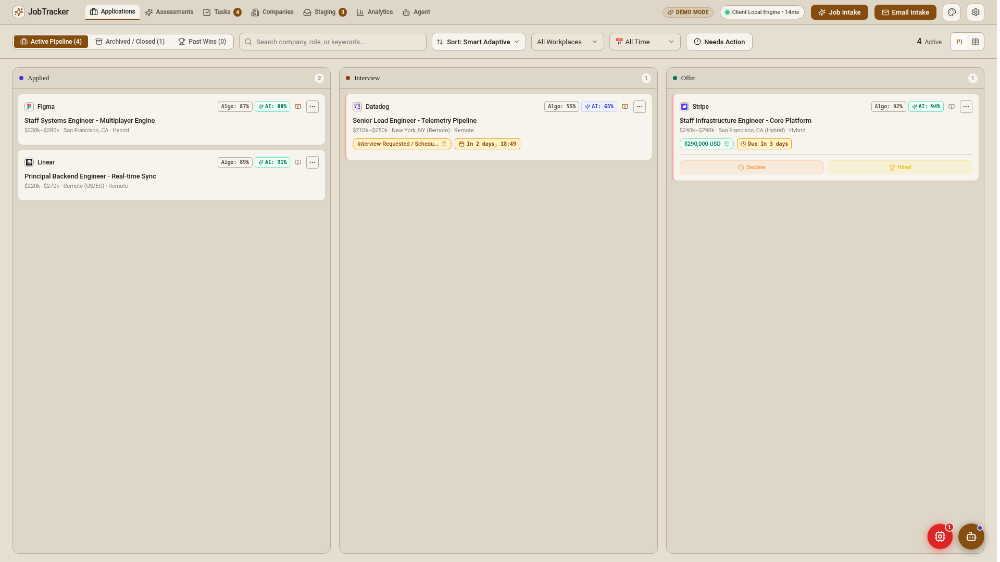
      <br />
      <strong>Applications Kanban</strong><br />
      <sub>4 active stages, interview countdowns, salary badges, and Past Wins</sub>
    </td>
    <td width="50%" align="center">
      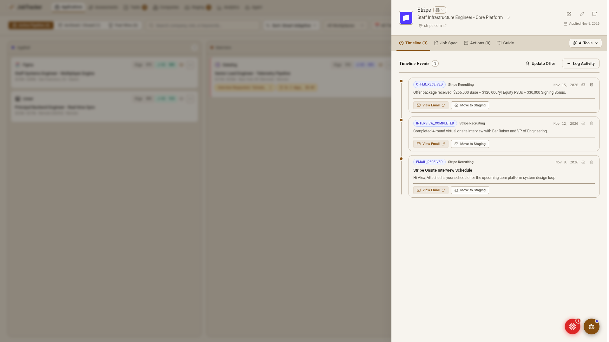
      <br />
      <strong>Application Detail Drawer</strong><br />
      <sub>Timeline events, job spec breakdown, action items, and interview guide</sub>
    </td>
  </tr>
  <tr>
    <td width="50%" align="center">
      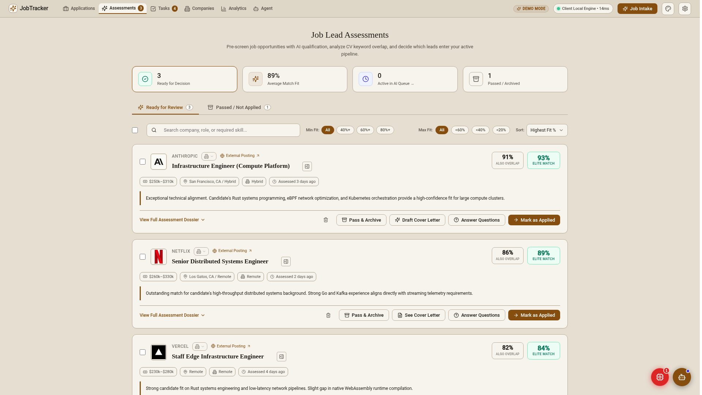
      <br />
      <strong>AI Job Fit Assessments</strong><br />
      <sub>Dual algorithmic + AI match scores, gap dossiers, and cover letters</sub>
    </td>
    <td width="50%" align="center">
      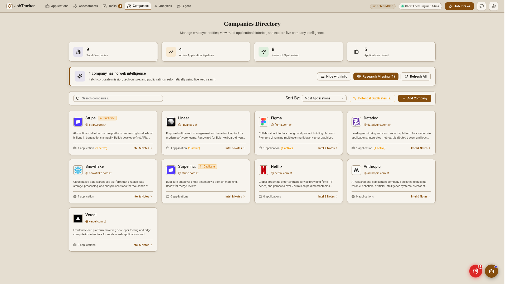
      <br />
      <strong>Companies Directory</strong><br />
      <sub>Employer entities, duplicate merge review, and live web intelligence</sub>
    </td>
  </tr>
</table>

### AI Agent, Interview Simulator & System Design Lab

<table>
  <tr>
    <td width="50%" align="center">
      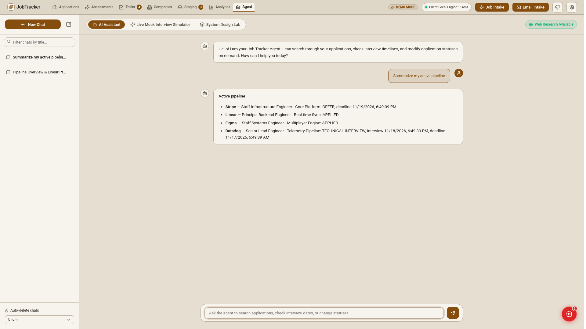
      <br />
      <strong>Agent Chat Assistant</strong><br />
      <sub>23+ tools for pipeline queries, cover letters, and live research</sub>
    </td>
    <td width="50%" align="center">
      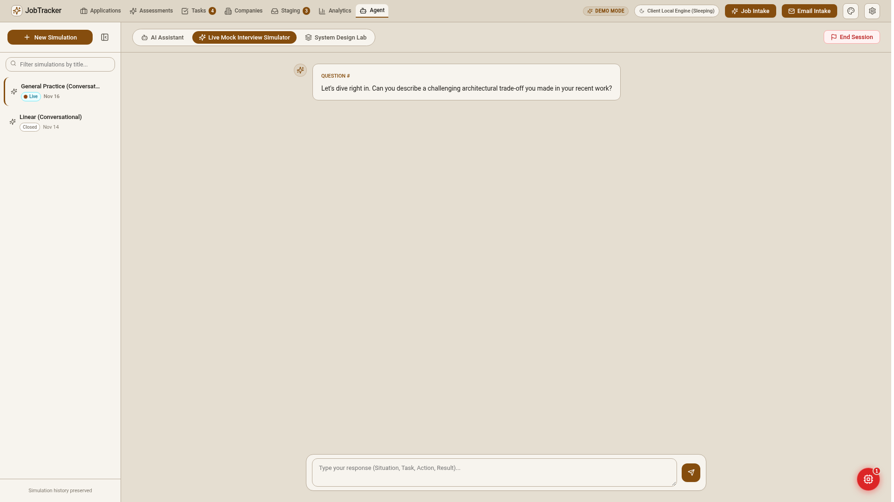
      <br />
      <strong>Live Mock Interview Simulator</strong><br />
      <sub>Multi-turn STAR drills with specialized personas and debrief scorecards</sub>
    </td>
  </tr>
  <tr>
    <td width="50%" align="center">
      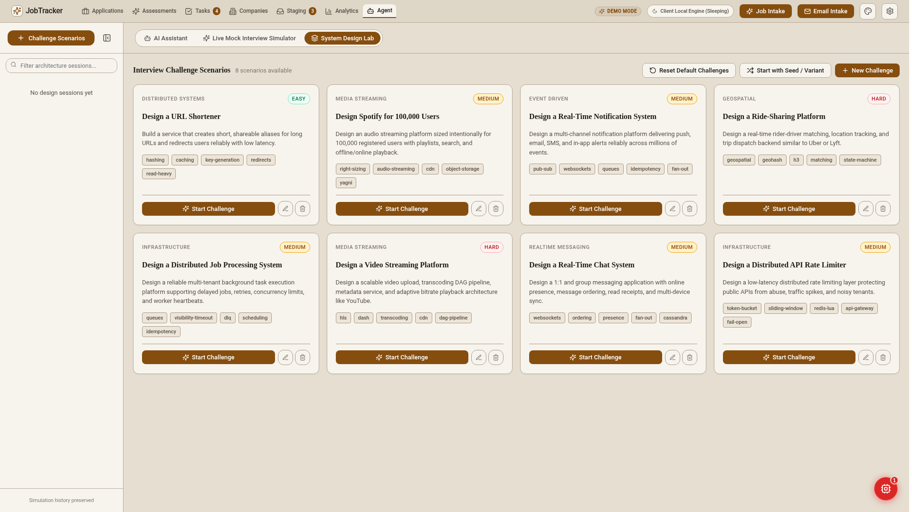
      <br />
      <strong>System Design Lab — Challenges</strong><br />
      <sub>Curated &amp; custom blueprints with Seed/Variant difficulty paths</sub>
    </td>
    <td width="50%" align="center">
      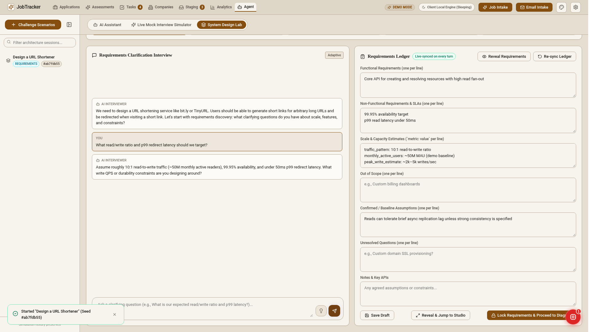
      <br />
      <strong>System Design Lab — Requirements</strong><br />
      <sub>Interactive clarifying Q&amp;A and live lockable requirements ledger</sub>
    </td>
  </tr>
  <tr>
    <td width="50%" align="center">
      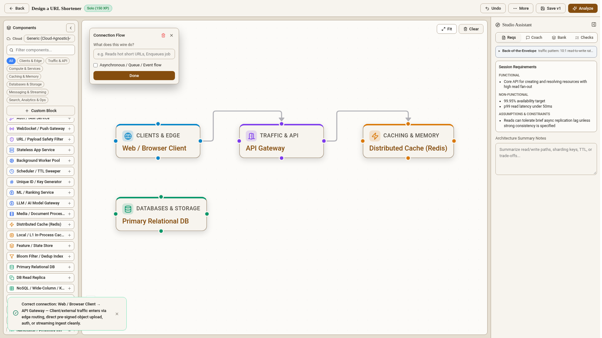
      <br />
      <strong>System Design Lab — Studio Canvas</strong><br />
      <sub>Drag-and-drop architecture diagramming, edge wiring, and multimodal review</sub>
    </td>
    <td width="50%" align="center">
      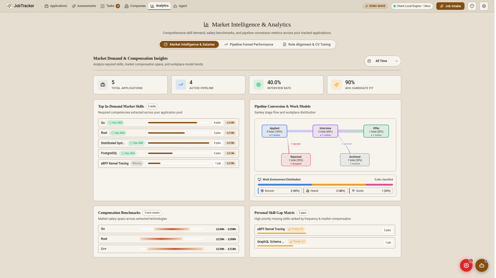
      <br />
      <strong>Analytics &amp; Role Alignment</strong><br />
      <sub>Sankey pipeline conversion, skill demand benchmarks, and CV tuning</sub>
    </td>
  </tr>
</table>

---

## 🧭 Platform Overview

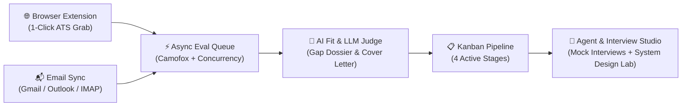

---

## 🌟 Why Job Tracker?

| Capability | Highlights |
| :--- | :--- |
| 🔒 **Self-Hosted & Privacy-Configurable** | Run the full stack on infrastructure you control. Use local models (**LM Studio**, **Ollama**, **vLLM**, **SGLang**) with idle VRAM release, or opt into cloud providers (**OpenAI**, **Anthropic**, **Gemini**, **OpenRouter**). |
| 🏗️ **Interactive System Design Lab** | Practice 24 curated blueprints across 6 stages: clarifying requirements discovery, lockable ledger, interactive Studio canvas & `v1..vN` diagram uploads, multimodal vision review, trade-off defence, and final scorecard. |
| 🎙️ **Live Mock Interview Simulator** | Multi-turn voice and text simulations featuring specialized interviewer personas (*Technical Bar Raiser*, *Hiring Manager*, *Behavioral Coach*) and real-time STAR debrief scorecards. |
| 🤖 **Deep AI Fit & Zero-Hallucination Judge** | Granular hard/soft skill breakdown, algorithmic + AI scoring, custom cover letters, application form Q&A, and automated `llm_judge` verification grounded strictly in your CV. |
| 🧪 **Prompt Eval Studio & Frontier Bridges** | Run A/B prompt evaluations in Settings against offline golden datasets, or export/import structured Frontier briefs across deliverables and System Design reviews. |
| 📬 **Automated Email Sync & Tiebreaker** | Connects to **Gmail**, **Outlook**, or **IMAP** with calendar revision tracking and a gray-zone LLM match tiebreaker to extract interview schedules and action items automatically. |
| 🏢 **Companies Directory & Live Intelligence** | Unified employer directory (`/companies`), cross-application history, `pg_trgm` duplicate merge review, candidate pros/red flags, and web synthesis via DuckDuckGo / SearXNG. |
| 🎯 **Role Alignment & CV Tuning** | AI career intelligence dossiers: executive market positioning, quantified resume bullet rewrites, strategic interview talking points, and skill bridge roadmaps. |
| ⚡ **Async Evaluation Queue** | Central background task manager (`/queue`) with per-provider concurrency ceilings, priority preemption, live stage steppers, bulk retries, and cancellation. |
| 🌐 **1-Click Browser Capture** | Floating capture dock for **LinkedIn**, **Indeed**, **Greenhouse**, **Lever**, **Workday**, and **Ashby**, with universal DOM fallback parsing. |
| 📋 **Smart Kanban Pipeline** | 4 active stages (`APPLIED`, `ONLINE_ASSESSMENT`, `TECHNICAL_INTERVIEW`, `OFFER`), scheduled interview countdowns, automated staleness sweeper, and Past Wins archive. |
| 💰 **Token Pricing & Cloud Savings** | Real-time diagnostic telemetry (`/diagnostics`) tracking execution latency, trace spans, token consumption, dollar costs, and local LLM cloud savings. |

---

## 🚀 60-Second Quickstart

<details open>
<summary><strong>Linux &amp; macOS</strong></summary>

```bash
git clone https://github.com/Joel-Duarte/job-tracker.git
cd job-tracker
./jt start
```

</details>

<details>
<summary><strong>Windows (CMD / PowerShell)</strong></summary>

```cmd
git clone https://github.com/Joel-Duarte/job-tracker.git
cd job-tracker
jt.cmd start
```

</details>

<details>
<summary><strong>Direct Docker Compose</strong></summary>

```bash
docker compose up -d
```

</details>

### 🌐 Access URLs & Ingress Architecture

Job Tracker uses a **closed-by-default, single-port ingress architecture**. All backend, database, and scraper services run inside a private Docker network and are accessed through the Frontend Reverse Proxy:

| Surface | Production (`./jt start`) | Development (`./jt dev`) |
| :--- | :--- | :--- |
| **Web Application** | `http://localhost:4173` | `http://localhost:5173` |
| **Swagger UI (API Docs)** | `http://localhost:4173/api/docs` | `http://localhost:5173/api/docs` |
| **ReDoc** | `http://localhost:4173/api/redoc` | `http://localhost:5173/api/redoc` |
| **API Base Path** | `http://localhost:4173/api/v1/...` | `http://localhost:5173/api/v1/...` |

> **Security note:** Frontend, backend, and database ports bind to `127.0.0.1` by default. Bundled Camofox runs on an internal Docker network via `scraper-api` with an egress guard and has no published host port.

---

## 🛠️ Unified CLI Management (`./jt` / `jt.cmd`)

| Command | Usage | Description |
| :--- | :--- | :--- |
| `start` | `./jt start [--clean] [--open]` | Start production stack in background (`--clean` resets DB; `--open` launches browser). |
| `dev` | `./jt dev [--reset]` | Start live development environment with isolated dev DB, hot reloading, and mock seed data. |
| `stop` | `./jt stop` / `jt.cmd stop` | Gracefully stop all Job Tracker containers. |
| `status` | `./jt status` / `jt.cmd status` | Display container health, exposed ports, and runtime status. |
| `logs` | `./jt logs [service]` | Stream live container logs (`backend`, `frontend`, `db`, `scraper`). |
| `open` | `./jt open` / `jt.cmd open` | Open the Job Tracker web application in your default browser. |
| `backup` | `./jt backup` | Save a standalone PostgreSQL database snapshot to `backups/`. |
| `update` | `./jt update` | Snapshot PostgreSQL to `backups/`, pull latest changes, rebuild services, and migrate. |
| `clean` / `reset` | `./jt clean` / `jt.cmd clean` | Wipe PostgreSQL volumes and restart with a clean slate (prompts for confirmation). |
| `seed` | `./jt seed` | Synthesize fresh domain-tailored mock job leads via your local LLM. |

---

## 🧩 Feature Tour

### 1. Smart Kanban Pipeline & Stage Tracking
Track applications across 4 active stages with automatic countdowns for scheduled interviews and decision deadlines.

```
┌─────────────────┐   ┌─────────────────┐   ┌─────────────────┐   ┌─────────────────┐
│   📝 APPLIED    │──▶│ 💻 ONLINE ASMT  │──▶│ 🎙️ TECH INTRVW  │──▶│   🎉 OFFER      │
│ 5 Applications  │   │ 2 In Progress   │   │ In 2 days (10am)│   │ Decision: Dec 15│
└─────────────────┘   └─────────────────┘   └─────────────────┘   └─────────────────┘
                                                       │
                     ┌─────────────────────────────────┴───────────────────┐
                     ▼                                                     ▼
           🏆 HIRED / ACCEPTED                                    📦 ARCHIVED / WITHDRAWN
```

### 2. Deep AI Fit & Gap Dossier
Compare candidate CV profiles directly against ingested job descriptions using multi-agent LangGraph workflows and `llm_judge` factuality checks.

```
  MATCH SCORE: 92% (Strong Fit)
  ├── 🟢 Core Competencies: Distributed Systems, Async Python, PostgreSQL (100% Match)
  ├── 🟡 Missing / Desired Skills: Rust, eBPF (Identified & Highlighted)
  ├── 📄 Generated Pitch: "Staff-level expertise scaling async pipelines with pgvector..."
  └── ✍️ Custom Cover Letter: Zero-hallucination 1-click export grounded in verified CV facts
```

### 3. Live Interactive Mock Interview Simulator
Practice behavioral, technical, and system design interviews tailored specifically to your target role.

```
  Interviewer Persona: [ 🛡️ Technical Bar Raiser ]
  Question Mode:       [ 💬 Multi-Turn STAR Drill ]

  Interviewer ❯ "Walk me through how you resolved a high-concurrency race condition in Postgres."
  Candidate   ❯ "We encountered deadlocks during peak write traffic on our booking ledger..."

  [ Real-Time STAR Feedback ]
  ├── Situation & Task: Clear and structured (Score: 9/10)
  ├── Action: Strong technical depth on row-level locking (Score: 10/10)
  └── Result: Quantified latency reduction by 40% (Score: 9/10)
```

### 4. Interactive System Design Lab & Studio Canvas
Master system design across 24 curated blueprints (and custom AI-generated scenarios) with a full 6-stage loop:

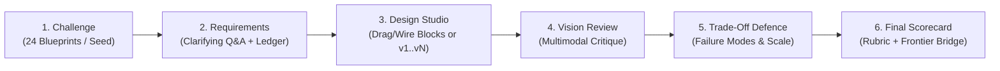

### 5. Automated Email Sync & Action Item Extraction
Connect recruitment mailboxes via IMAP or OAuth (Gmail & Outlook) to synchronize recruitment updates, resolve calendar revisions, and populate to-do action items—backed by a gray-zone LLM tiebreaker for ambiguous threads.

```
  📬 Inbound Email: "Invitation to Technical Interview at Figma"
  ├── 📅 Event Detected: Technical Interview on Thursday at 2:00 PM GMT
  ├── 🔄 Pipeline Action: Auto-transitioned application to "TECHNICAL_INTERVIEW"
  └── ✅ Action Item Created: "Confirm video call attendance with recruiter" (Due in 24h)
```

### 6. Companion Browser Extension
Capture job postings while browsing without switching tabs.

```
  ┌────────────────────────────────────────────────────────┐
  │ 🦊 Job Tracker Companion Dock                          │
  ├────────────────────────────────────────────────────────┤
  │ Role: Senior Distributed Systems Engineer              │
  │ Company: Stripe (stripe.com)                           │
  │ Location: Remote / San Francisco                       │
  │                                                        │
  │ [ ⚡ Enqueue AI Assessment ]   [ 📌 Save Directly ]   │
  └────────────────────────────────────────────────────────┘
```

### 7. Employer Directory & Live Company Intelligence
Consolidate employer entities, cross-application history, candidate pros/red flags, and live web research synthesized from DuckDuckGo and SearXNG.

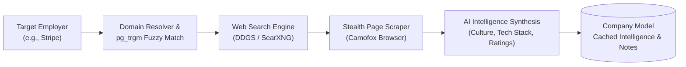

### 8. Strategic Role Alignment & CV Tuning
Generate deep career positioning dossiers linking your candidate CV to specific career tracks. Elevate resume bullets, prepare high-stakes technical talking points, and identify critical bridge skills.

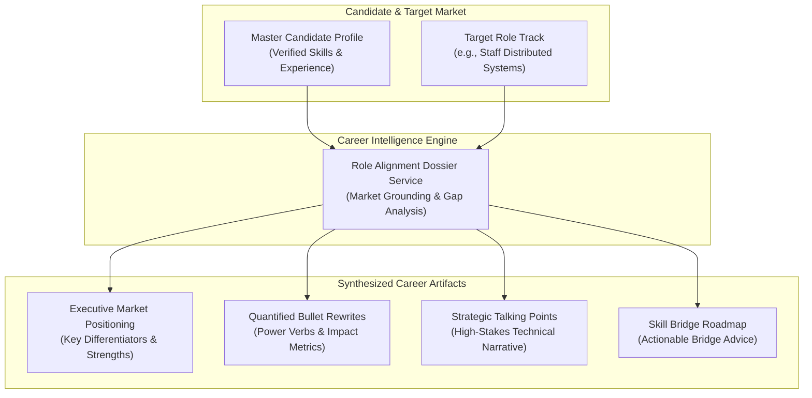

### 9. Async Evaluation Queue & Prompt Eval Studio
Queue intensive evaluations asynchronously with per-provider concurrency ceilings, priority preemption, and live stage steppers—and validate prompt edits in Settings against offline golden datasets before saving.

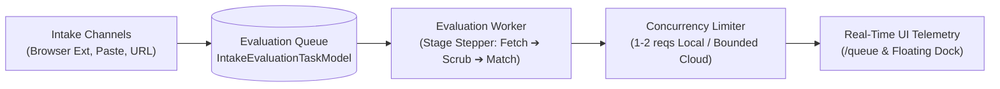

---

## 📚 Documentation & Deep Dives

| Document | Description |
| :--- | :--- |
| [`docs/QUICKSTART.md`](docs/QUICKSTART.md) | Installation steps, first-run setup, and troubleshooting. |
| [`docs/USER_GUIDE.md`](docs/USER_GUIDE.md) | Guide to job intake, AI analysis, System Design Lab, mock interviews, and tracking. |
| [`docs/AI_PROVIDERS.md`](docs/AI_PROVIDERS.md) | Local/cloud AI provider bindings, Prompt Eval Studio, and Frontier bridges. |
| [`docs/OAUTH_SETUP.md`](docs/OAUTH_SETUP.md) | Gmail and Outlook OAuth setup and IMAP app passwords. |
| [`docs/EXTERNAL_SERVICES.md`](docs/EXTERNAL_SERVICES.md) | Connecting external PostgreSQL databases and Camofox scraper instances. |
| [`docs/ARCHITECTURE.md`](docs/ARCHITECTURE.md) | System architecture, LangGraph workflows, vector search, and System Design Lab internals. |
| [`docs/UI_QA.md`](docs/UI_QA.md) | Playwright E2E coverage contract, visual regression, and CI workflow. |
| [`extension/README.md`](extension/README.md) | Companion browser extension installation and setup. |
| [`backend/README.md`](backend/README.md) | Backend development, API, testing, and database migrations. |

---

## ⚙️ Tech Stack Summary

| Component | Technology | Description |
| :--- | :--- | :--- |
| **Frontend** | Vue 3 (Composition API), Vite, Pinia, Vue Flow, Lucide Icons | High-performance SPA with Daylight/Midnight themes, Kanban drag-and-drop, interactive System Design canvas, and radar scorecards. |
| **Backend API** | FastAPI, Python 3.12, AsyncIO, Uvicorn | Async REST API and WebSocket gateway with non-blocking database queries and worker orchestration. |
| **AI Orchestration** | LangChain, LangGraph, Pydantic | Tool-using conversational assistant, candidate fit workflows, `llm_judge` auditing, System Design Lab, and prompt golden evals. |
| **Database & Vector Search** | PostgreSQL 16, pgvector, pg_trgm, SQLAlchemy 2 | Relational storage, vector similarity search, fuzzy full-text matching, and Alembic migrations. |
| **Stealth Scraper** | Camofox (Headless Firefox Engine) | Anti-bot evasion, dynamic JavaScript execution, cookie dismissals, and high-fidelity DOM extraction. |
| **Web Search & Limiter** | DuckDuckGo, SearXNG, Token Bucket Limiter | Multi-engine web intelligence retrieval with automatic health fallback and domain-anchored company profiling. |
| **Browser Extension** | WebExtensions Manifest V3 | Cross-browser floating capture dock for Chrome, Brave, Edge, and Firefox with background sync. |

---

## 🤝 Contributing

Bug reports and feature requests are welcome. If you plan to submit code, open an issue first to discuss scope and contribution terms. The project is licensed under PolyForm Noncommercial; including contributed code in a separately commercially licensed distribution requires the contributor's separate written permission.

### Development Workflow

1. **Set Up Pre-Commit Hooks:**
   ```bash
   uv run --directory backend pre-commit install
   ```

2. **Run Quality Verification:**
   Before submitting changes, execute [`scripts/pre-commit.sh`](scripts/pre-commit.sh):
   ```bash
   ./scripts/pre-commit.sh
   ```
   This runs:
   - Backend Ruff format & lint checks (`uv run ruff format --check .`, `uv run ruff check .`)
   - Backend Pytest suite (`uv run pytest`)
   - Frontend Vite build & checks (`npm run build`)

---

## 📄 License

This is a source-available project under the **PolyForm Noncommercial License 1.0.0**, not an OSI-approved open-source license. The license permits noncommercial use, modification, and redistribution; commercial use requires separate permission from the copyright holder. See [LICENSE](LICENSE) for the terms.

> Noncommercial use is permitted under the license terms, which also define permitted personal and organizational uses. Commercial use requires separate written permission from the copyright holder (Joel Duarte).
